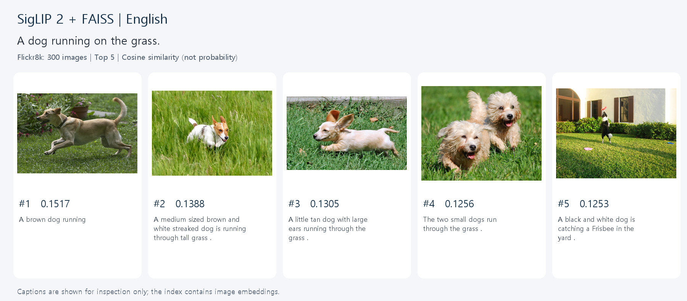
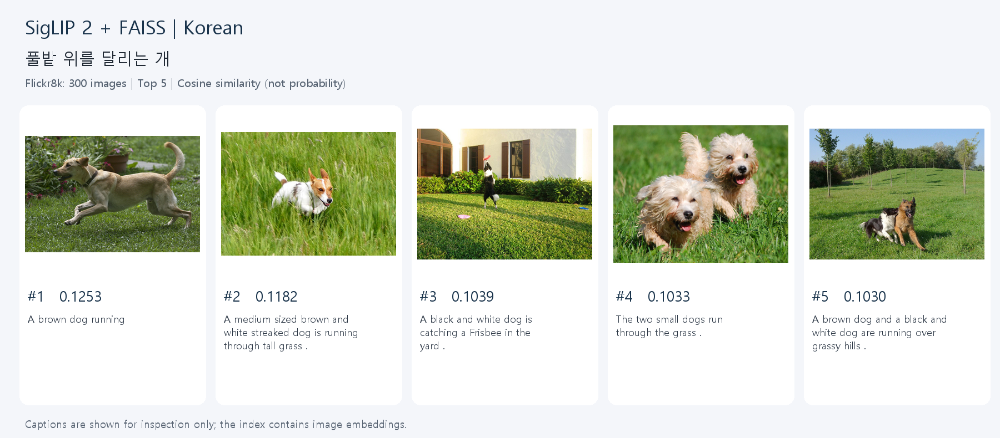

# 5주차 — SigLIP 2 + FAISS 이미지 검색

임지민 · DRAG

## 무엇을 만들었나요?
사진 300장을 SigLIP 2로 숫자 벡터로 바꿔 FAISS에 저장했습니다. 문장을 입력하면 같은 모델의 텍스트 인코더로 변환하여 가까운 사진 5장을 찾습니다. 영어와 한국어 질문을 각각 실행하고, 원본 영어 캡션 1,500개로 Recall@K도 계산합니다. 답변 생성 챗봇과 달리 이번 과제는 **텍스트로 이미지를 찾는 검색 시스템**입니다.

## 파일 안내
| 파일 | 역할 |
|---|---|
| `SigLIP_FAISS_실습.ipynb` | 설명·코드·실행 결과가 들어 있는 제출용 노트북 |
| `week5_pipeline.py` | 노트북 핵심 함수를 재사용할 수 있는 파이썬 모듈 |
| `execute_notebook.py` | 노트북 전체를 실행하고 출력까지 저장하는 도구 |
| `requirements.txt` | 설치할 라이브러리 목록 |
| `results/query_*_english.png` | 영어 질문의 실제 Top 5 검색 결과 |
| `results/query_*_korean.png` | 같은 의미의 한국어 질문 결과 |
| `results/images.faiss` | 저장된 이미지 벡터 검색 인덱스 |
| `results/manifest.json` | 벡터 순서에 대응하는 이미지 ID·경로·캡션·해시 |
| `results/metrics.json` | 실행 환경과 Recall@1/5/10 |
| `results/evaluation_details.json` | 1,500개 질의의 정답 순위·Top 10 기록 |
| `ISSUES.md` | 구현 중 해결한 문제와 배운 점 |

## 다른 컴퓨터에서 실행
Python 3.11 또는 3.12를 권장합니다. GitHub에서 저장소를 내려받은 후 이 폴더로 이동하세요. 원본 사진과 모델 가중치는 저장소에 포함하지 않으며 첫 실행 시 자동 다운로드합니다. API 키·유료 서비스는 필요 없습니다. 인터넷, 수 GB의 여유 공간과 충분한 메모리가 필요하며 CPU에서는 시간이 걸릴 수 있습니다.

Windows PowerShell:
```powershell
py -3.11 -m venv .venv
.\.venv\Scripts\python.exe -m pip install -r requirements.txt
.\.venv\Scripts\python.exe -m jupyterlab
```
Mac 터미널:
```bash
python3 -m venv .venv
source .venv/bin/activate
python -m pip install -r requirements.txt
python -m jupyterlab
```
JupyterLab에서 `SigLIP_FAISS_실습.ipynb`를 열고 **Run → Run All Cells**를 누릅니다. 결과 캡처와 평가 파일은 `results/`에 자동 저장됩니다. Mac 실기기 실행은 검증하지 않았습니다.

화면 없이 전체 실행하려면 설치한 환경에서 `python execute_notebook.py`를 실행합니다. 기존 RAG 프로젝트의 `run_chatbot.bat`와 별개인 5주차 제출물입니다.

## 실험 조건과 해석
- 데이터: Hugging Face `intro/flickr8k`, test split 1,000장 중 seed 42로 고정 추출한 300장. 데이터 revision은 코드에 고정했습니다.
- 이미지마다 원본 영어 캡션 5개를 보존합니다. 캡션은 검색 인덱스에 넣지 않습니다.
- 모델: `google/siglip2-base-patch16-224`. SigLIP 계열의 다국어 후속 모델이며 이번에는 CPU float32로 실행합니다.
- FAISS: 출력 차원을 자동 확인하고, 이미지·텍스트를 L2 정규화한 뒤 `IndexFlatIP`로 검색합니다. 유사도는 확률이 아닙니다.
- Recall@K는 300장 후보 안에서 정답 사진을 찾는 영어 캡션 평가입니다. 전체 Flickr8k 공식 벤치마크 또는 한국어 정량 성능으로 해석하면 안 됩니다.
- 모델 학습·미세조정은 하지 않았으며 사전학습 자료와의 중복은 알 수 없습니다.
- 모델 다운로드 후 이미지 준비가 끝나면 검색 추론은 로컬에서 실행됩니다.

## 원본에서 바꾼 부분
원본의 오프라인 이미지 인덱싱 → 온라인 텍스트 인코딩 → FAISS 검색 → 이미지 출력 흐름을 기반으로 모델, 데이터, CPU 실행 및 평가를 변경했습니다.

| 원본 | 이번 과제 |
|---|---|
| MetaCLIP2 worldwide giant | 다국어 SigLIP 2 base |
| 음식 사진 | 캡션이 있는 Flickr8k 300장 |
| FAISS GPU·1,280차원 고정 | FAISS CPU·실제 출력 차원 자동 사용 |
| 정규화 벡터의 L2 거리 | 정규화 벡터의 내적(코사인 유사도) |
| 영어·프랑스어 검색 | 영어·한국어 두 쌍 비교 |
| 이미지 출력 | 실행된 노트북·PNG·인덱스·Recall@K 저장 |

## 출처
- 기반 노트북: https://github.com/merveenoyan/smol-vision/blob/main/Image_Search_with_MetaCLIP2.ipynb
- SigLIP 2 모델 카드: https://huggingface.co/google/siglip2-base-patch16-224
- 데이터 패키지: https://huggingface.co/datasets/intro/flickr8k
- Flickr8k 연구: Hodosh, Young, Hockenmaier (2013), Framing Image Description as a Ranking Task.
- FAISS 코사인 검색: https://github.com/facebookresearch/faiss/wiki/MetricType-and-distances

원본 데이터셋 전체·모델 가중치는 업로드하지 않습니다. 결과에 사용한 사진은 Flickr8k에서 왔으며, 데이터 패키지의 표기와 별개로 원본 사진의 이용 조건을 확인하세요.


## 실제 실행 결과 (2026-10-11)
Windows · Python 3.12.14 · CPU에서 노트북 전체 실행 완료. 300개 이미지가 **768차원** 벡터로 인덱싱됐습니다.

| 지표 | 결과 | 의미 |
|---|---:|---|
| Recall@1 | 85.53% (1,283/1,500) | 정답 사진이 1위 |
| Recall@5 | 98.27% (1,474/1,500) | 정답 사진이 상위 5장 안 |
| Recall@10 | 99.33% (1,490/1,500) | 정답 사진이 상위 10장 안 |

300장 후보에 대한 영어 캡션 검색 결과이며 전체 데이터셋 성능을 의미하지 않습니다. 평가의 분모·분자는 `evaluation_details.json`에서 재계산 검증했습니다. `python verify_results.py`로 모델을 다시 실행하지 않고 제출물 정합성을 확인할 수 있습니다.

영어·한국어 모두 '풀밭 위를 달리는 개'에 같은 사진이 1위였습니다. '물에서 놀고 있는 아이'는 관련 사진을 찾았지만 언어별 순위가 달랐습니다. 서로 다른 언어의 유사도 숫자를 직접 정확도처럼 비교하지 않습니다.

### 영어 검색 결과


### 한국어 검색 결과


추가 비교: [영어: 물놀이](results/query_2_english.png), [한국어: 물놀이](results/query_2_korean.png).

이 실행에서 재사용한 모델 캐시 revision은 `75de2d55ec2d0b4efc50b3e9ad70dba96a7b2fa2`입니다. 신규 설치에서는 모델 저장소의 기본 revision을 다운로드하므로 향후 업데이트에 따라 수치가 달라질 수 있습니다. 검증한 패키지 버전은 `verified_versions.json`에 있습니다.
