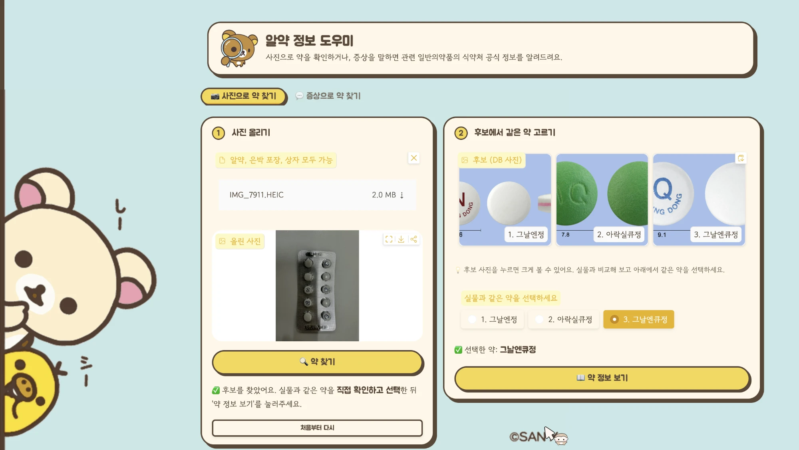

# 💊 알약 정보 도우미 — 개발일지

> 알약 사진 또는 증상을 입력하면, 식약처 공식 정보를 근거로 일반의약품 정보를 안내하는 멀티모달 RAG 챗봇
>
> TAVE 18기 DRAG 스터디 팀 프로젝트 · **김가은 (텍스트 RAG)** · **유연 (이미지 식별)**



| 서비스 범위 | 텍스트 청크 | 이미지 벡터 | 사진 식별 Top-1 (실물 33장) |
| :---: | :---: | :---: | :---: |
| **2,744종** | **16,811개** | **8,176개** | **66.7%** |

- 서비스 내용, 기능·데이터·모듈 명세, 실행 방법은 **[docs/SPEC.md](docs/SPEC.md)** 한 페이지에 모았습니다.
- 이 문서는 개발 과정을 시간순으로 기록한 개발일지입니다. 날짜는 작업 파일의 마지막 수정일을 기준으로 정리했습니다.

---

## 만들려고 한 것

약 이름을 모르는 사람도 **사진 한 장** 또는 **증상 한 줄**로 안전하게 약 정보를 확인할 수 있게 하는 것이 목표였습니다.

| 기능 | 흐름 |
| --- | --- |
| 📷 사진으로 약 찾기 | 사진 업로드 → 후보 3개 → 실물과 비교해 선택 → 복용법·주의사항 → 추가 질문 |
| 💬 증상으로 약 찾기 | 증상 입력 → 위험 증상 확인 → 관련 일반의약품 2~3개를 공식 효능과 함께 예시로 안내 |

처음부터 정한 원칙은 두 가지입니다.

1. **근거 없는 말은 하지 않는다.** 식약처 자료에 있는 내용만 답하고, 출처(약 이름 + 섹션)를 붙입니다.
2. **약을 대신 확정하지 않는다.** 사진 식별은 후보 3개를 보여주고 사용자가 실물과 비교해 고릅니다.

---

## 개발일지

### 10/11 — 데이터 확보
- 식약처 **의약품 낱알식별정보**(25,445건)와 **의약품개요정보(e약은요)**(4,746건)를 내려받았습니다.
- 낱알식별정보에는 사진·각인·색·모양이, e약은요에는 효능·복용법·주의사항이 있어서 두 자료를 `ITEM_SEQ`로 합치면 "생김새로 약을 찾고, 설명은 공식 문서에서 가져오는" 구조가 됩니다.

### 10/12 — e약은요 수집, 이미지 인덱스 구축
- 공공데이터포털 API로 e약은요를 전체 페이지 순회 수집하는 스크립트를 작성했습니다 (`data_prep/fetch_eyak.py`).
- 이미지 쪽에서는 DB 낱알 사진과 알약 영역 크롭을 준비하고, **SigLIP2(so400m-patch14-384)** 로 임베딩해 FAISS 인덱스를 만들었습니다. 한 약당 전체 사진 + 크롭 최대 2장이라 벡터는 8,176개(2,736종)입니다.

### 10/13 — 실물 평가 세트와 첫 식별 파이프라인
- 직접 촬영한 **실물 사진 33장**(11개 약 × 앞면·뒷면·상자)을 평가 세트로 만들었습니다 (`pill_chatbot/test_labels.csv`).
- `identify.py`에서 "VLM이 각인·색·모양을 읽고 → SigLIP 검색 결과와 점수를 합쳐 후보 3개를 만드는" 구조를 구현했습니다.
- 로컬 VLM(Qwen2.5-VL-3B)으로 먼저 돌려 봤더니 결합해도 **Top-1 27.3%** 로 낮았습니다.

### 10/14 — Gemini로 교체, 가중치 확정, 마스터 테이블
- VLM을 Gemini로 바꿔 다시 평가했습니다. VLM만 쓰면 60.6%, SigLIP2만 쓰면 15.2%였습니다.
- 각인·이미지·색/모양 가중치를 조정해 **0.6 / 0.2 / 0.2** 로 확정했고 최종 **Top-1 66.7%** 가 나왔습니다 (`pill_chatbot/index/identify_config.json`).
- 두 데이터를 `ITEM_SEQ`로 조인하고 일반의약품만 남겨 **마스터 테이블 2,744종**을 만들었습니다 (`data_prep/build_master.py`).
  - e약은요에는 이미지 컬럼만 다른 중복 행이 있어 첫 행만 남겼습니다.
  - 낱알식별정보의 중복은 함량별로 모양·각인이 다른 별개 낱알이라 그대로 두었습니다.

### 10/15 ~ 10/16 — 텍스트 검색 준비
- 증상 검색용으로 효능 청크를 `BAAI/bge-m3`로 임베딩해 캐시했습니다 (10/15).
- 마스터 테이블을 (품목, 섹션) 단위로 쪼개 **청크 16,811개**를 만들었습니다 (10/16).

### 10/17 — 웹 데모
- Gradio로 두 기능을 한 화면에 연결한 데모(`src/app.py`)를 만들었습니다.
- 1등 후보에 각인이나 제품명 근거가 없으면(생김새만으로 고른 경우) "확신 낮음"으로 표시하도록 했습니다.

### 10/18 — RAG 최종본, 화면 개선
- `src/rag.py`를 마무리했습니다.
  - 위험 증상 키워드면 약을 추천하지 않고 진료·119를 안내
  - 질문에 약 이름이 있는지, 사진으로 약을 이미 골랐는지에 따라 답변 방식 분기
  - 약만 고르고 질문이 없으면 LLM 없이 **고정 템플릿**으로 복용법·경고·주의사항 출력
  - 증상 검색은 BM25 + bge-m3를 RRF로 합치고 bge-reranker-v2-m3로 재정렬
  - 제형이 다른 같은 이름 제품은 한 문장으로 묶지 않고 제품별로 분리
- 화면을 **탭 구조**(사진으로 / 증상으로)로 바꾼 디자인을 두 가지 만들었고 (`src/app_eun_final.py`, `src/app_yeon.py`), Colab에서 실행하는 노트북을 정리했습니다.

### 10/19 — 데모 녹화
- 웹 화면을 녹화해 데모 영상으로 남겼습니다.

### 10/23 — 문서화와 정리
- 노션에 데이터셋·파이프라인·평가를 정리하고, 코드와 개발 문서를 이 저장소로 모았습니다.

---

## 겪은 문제와 해결

| 문제 | 해결 |
| --- | --- |
| SigLIP2만으로는 실물 사진 식별이 15.2%에 그침 | VLM이 읽은 **각인**을 가장 큰 가중치(0.6)로 결합 |
| 작은 로컬 VLM(3B)은 각인을 잘 못 읽음 | Gemini로 교체, 실패하면 SigLIP 점수만 쓰는 대체 경로 유지 |
| Gemini 호출이 한도·권한 오류(429/403/404)로 실패 | 예비 모델 목록과 재시도, 한도 초과는 기다리지 않고 다음 모델로 이동 |
| 약 이름이 같아도 제형이 다른 제품이 섞임 | 프롬프트에서 제품별 분리를 강제하고, 범위 밖 제형은 "포함되어 있지 않다"고 명시 |
| 비슷한 효능 문구의 약이 결과를 채움 | 같은 약은 한 번만, 효능 문구 유사도(토큰 Jaccard)가 0.85 이상이면 건너뜀 |
| GPU 없는 환경에서 재정렬이 느림 | 환경변수 `MEDBOT_RERANK=0`으로 끌 수 있게 함 |

## 배운 점

- 이미지 임베딩 하나로 "생김새가 비슷한 알약"을 구분하기는 어렵고, **글자(각인) 같은 확실한 단서와 결합**해야 의미 있는 정확도가 나왔습니다.
- 의료 정보는 **자료에 있는 것만 말하게 하고, 확정은 사람이 하게 하는 구조**가 서비스 설계의 핵심이었습니다.
- 평가 세트가 33장뿐이라 수치는 경향 확인용입니다. 더 많은 사진으로 다시 재야 합니다.

## 남은 과제

- 이미지 인덱스에 실제 촬영 사진을 추가하고 크롭 품질 개선
- 증상 검색(하이브리드 / 재정렬)의 정량 평가 — 질의–정답 쌍을 만들어 비교
- 위험 증상 판별을 키워드 규칙에서 분류 모델·LLM 보완으로 확장
- 시럽·액상 등 다른 제형으로 서비스 범위 확대

---

## 저장소 구성

```
src/                  identify.py(사진 식별) · rag.py(텍스트 RAG) · app*.py(Gradio 화면)
data_prep/            e약은요 수집, 마스터 테이블 생성
pill_chatbot/         master.parquet, chunks.parquet, 인덱스 설정·평가 결과
notebooks/            Colab 실행 노트북
docs/                 SPEC.md(개발명세서·서비스 설명), demo.png
```

용량이 큰 파일(FAISS 인덱스, 임베딩 캐시, 약 사진 zip, 테스트 사진)은 저장소에 넣지 않았습니다. 준비 방법은 [docs/SPEC.md](docs/SPEC.md#8-실행-방법)를 참고하세요.

> ⚠️ 이 서비스는 식품의약품안전처 공개 자료를 바탕으로 한 **참고용** 정보이며 진단이나 처방이 아닙니다. 복용 전 약사·의사와 상담하세요.
